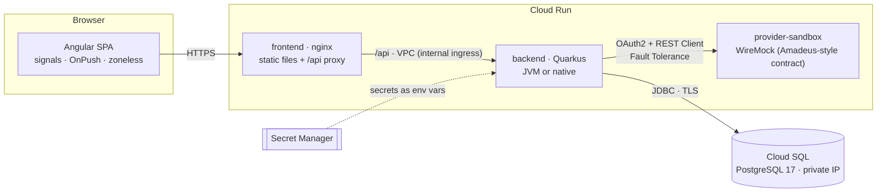
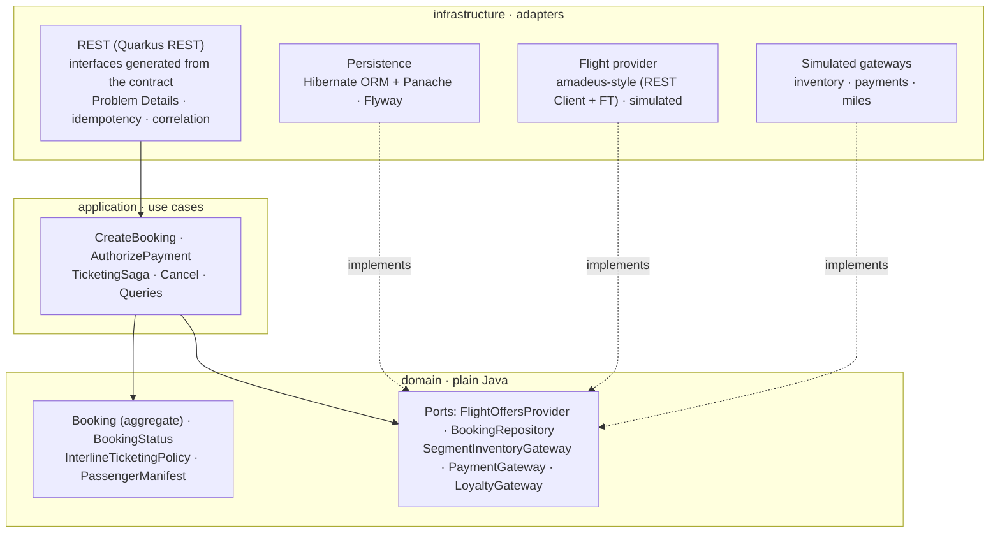
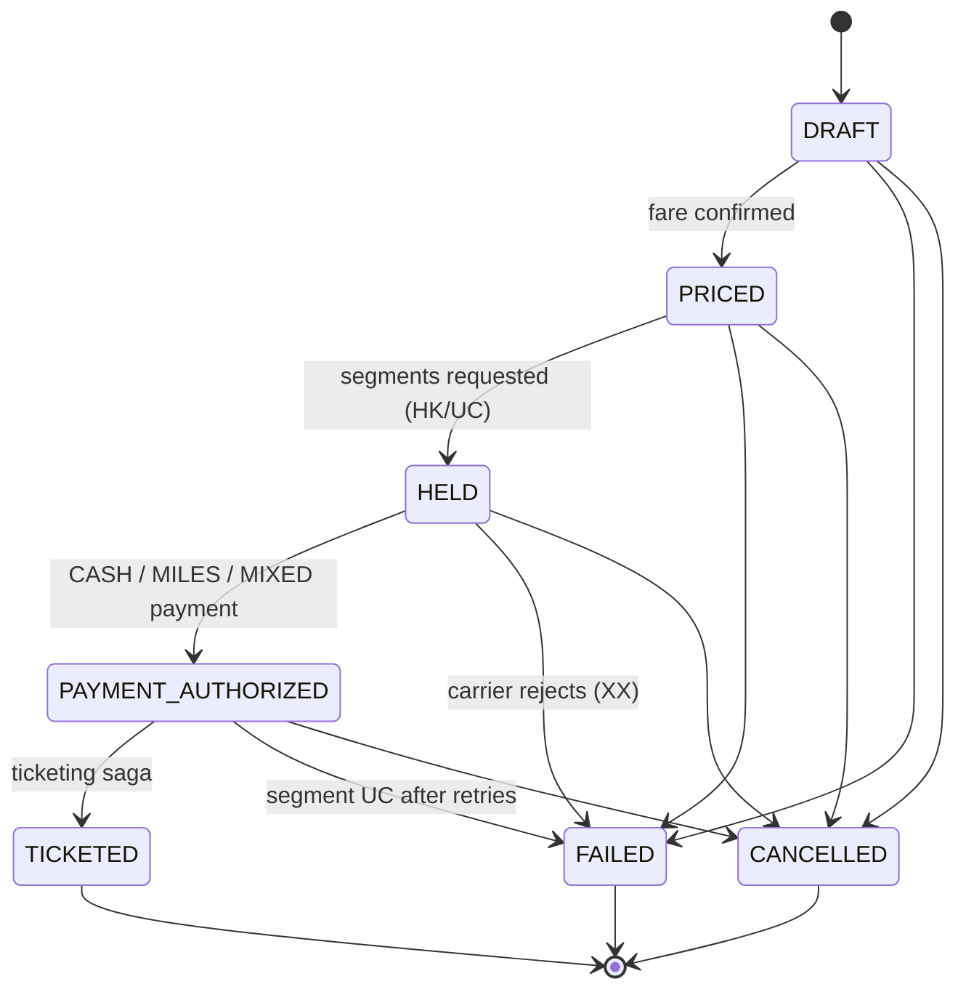
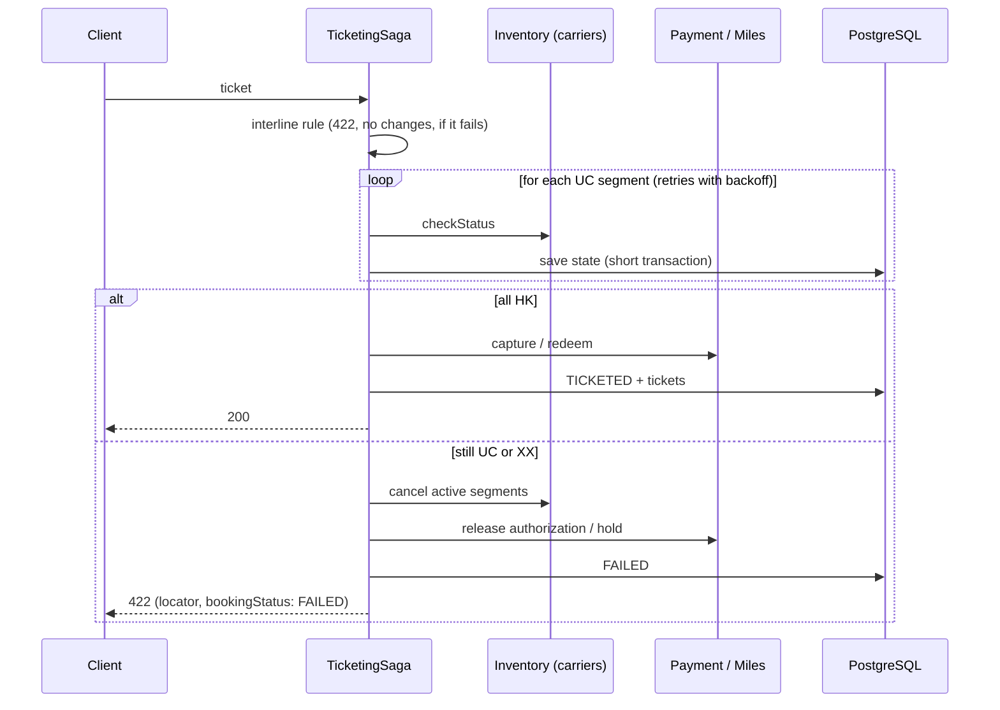

# Interline Booking Manager

*English · [Español](README.es.md)*

Booking management for itineraries that span several airlines issued on **a single ticket**
(*interline*), inspired by the white-label platforms airlines use to sell under their own
brand.

**Quarkus 3.40 LTS (Java 21) · Angular 22 · PostgreSQL 17 · Cloud Run · Terraform · GitHub Actions**

- **Core rule:** a single ticket is issued only if the validating carrier has an interline
  agreement with every operating carrier.
- **Orchestrated saga with compensation:** if a segment is still unconfirmed (UC) after the
  retries, the segments are cancelled, the payment or miles hold is released and the booking
  moves to `FAILED`.
- **Contract-first:** one OpenAPI contract generates both the backend JAX-RS interfaces and the
  frontend TypeScript types.
- **Amadeus-style flight provider** served by WireMock, with full resilience (timeout, retry
  with backoff, circuit breaker and fallback).
- **Runtime white-label:** colors, logo and name per airline from a JSON file, no rebuild
  needed.

> Demo data: airlines, flights, fares and interline agreements are **fictitious**.
> The frontend brands ("Aerolíneas Cóndor", "Pacífico Air") are made up.

## Architecture

### System



Locally, `docker compose` brings up the same thing: nginx → Quarkus → PostgreSQL, with WireMock
as the provider.

### Hexagonal backend



ArchUnit enforces these rules on every build:

- the domain does not import Jakarta, Quarkus, Hibernate or Jackson;
- there are no cycles between packages;
- DTOs do not leave the REST adapter;
- JPA entities do not leave infrastructure.

### Booking state machine



### Ticketing saga (`POST /bookings/{locator}/ticket`)



- Every step is idempotent and the saga state is the aggregate itself: if the process dies,
  repeating the request is enough.
- External calls are never made inside a database transaction.

## Repository layout

```
api/            OpenAPI 3.0.3 contract (single source of truth) + Redocly config
backend/        Quarkus · domain / application / infrastructure · Dockerfile (JVM) · Dockerfile.native
frontend/       Angular · step-by-step flow · manage view · white-label · Dockerfile (nginx) · Playwright e2e
wiremock/       Amadeus-style contract (mappings + __files) · sandbox Dockerfile
infra/          Terraform: bootstrap (WIF, state, CI accounts) and app (VPC, Cloud SQL, Cloud Run...)
.github/        Workflows ci.yml (build/test/analysis/images/deploy) and infra.yml (plan/apply)
docs/adr/       Architecture decisions, one per phase (in Spanish)
```

## Running locally

### Everything in Docker (only Docker required)

```bash
cp .env.example .env
docker compose up --build
# Frontend http://localhost:4200 (?tenant=LA for the other theme) · Swagger http://localhost:8080/swagger-ui

docker compose --profile observability up --build                        # + Jaeger on :16686
BACKEND_DOCKERFILE=backend/Dockerfile.native docker compose up --build   # native backend (~10 min, ~6 GB RAM)
E2E_BASE_URL=http://localhost:4200 npm --prefix frontend run e2e         # e2e against the stack
```

### Development (Java 21, Node 24.15 and Docker)

```bash
cd backend && ./mvnw quarkus:dev
# Dev Services starts PostgreSQL and WireMock. Hot reload, Dev UI at /q/dev-ui,
# continuous testing by pressing "r".

cd frontend && npm ci && npm start          # http://localhost:4200 (proxy /api → :8080)
```

### Tests

```bash
cd backend  && ./mvnw verify       # 181: domain, ArchUnit, @QuarkusTest (Dev Services), WireMock, resilience
cd frontend && npm run test:ci     # 43: store, validators, interceptors, mixed-payment split
cd frontend && npm run e2e         # 3: Playwright, full happy path against the real stack
terraform -chdir=infra/terraform/app init -backend=false && terraform -chdir=infra/terraform/app test   # 5 (mocks)
```

### Trying the saga with compensation

```bash
cd backend && ./mvnw quarkus:dev '-D%dev.app.simulated.inventory.never-confirm-carriers=IB'
# Book BOG → FCO (AV + IB), pay and ticket → 422 SEGMENT_NOT_CONFIRMED, booking FAILED,
# segments XX and payment RELEASED.
# The %dev prefix limits the simulated failure to the dev profile: continuous tests ("r" key)
# run in the same JVM with the test profile and still see IB confirming. Without the prefix,
# the system property applies to them too and the happy path fails.
```

### Flow with `curl`

```bash
OFFER=$(curl -s localhost:8080/api/v1/offers/search -H 'Content-Type: application/json' \
  -d '{"origin":"BOG","destination":"FCO","departureDate":"2026-12-15","passengers":{"adults":1}}' \
  | jq -r '.offers[0].offerId')

LOC=$(curl -s localhost:8080/api/v1/bookings -H 'Content-Type: application/json' \
  -H "Idempotency-Key: $(uuidgen)" \
  -d "{\"offerId\":\"$OFFER\",\"contact\":{\"email\":\"ana@example.com\"},
       \"passengers\":[{\"ref\":\"P1\",\"type\":\"ADT\",\"firstName\":\"Ana\",\"lastName\":\"Pérez\",\"dateOfBirth\":\"1990-04-12\"}]}" \
  | jq -r .locator)

AMOUNT=$(curl -s localhost:8080/api/v1/bookings/$LOC | jq .fare.total.amount)
curl -s localhost:8080/api/v1/bookings/$LOC/payments -H 'Content-Type: application/json' \
  -H "Idempotency-Key: $(uuidgen)" -d "{\"method\":\"CASH\",\"cash\":{\"amount\":$AMOUNT,\"currency\":\"USD\"}}" | jq .status
curl -s -X POST localhost:8080/api/v1/bookings/$LOC/ticket | jq '{status, tickets}'
```

## Deploying to GCP

The full guide (in Spanish) is in **[infra/README.md](infra/README.md)**. In short:

1. `infra/terraform/bootstrap` (once, by hand): APIs, state bucket, Workload Identity
   Federation and CI accounts.
2. Load the provider credentials with `gcloud secrets versions add ... --data-file=-`.
3. In GitHub, create the **variables** the bootstrap outputs, plus the `infrastructure` and
   `production` environments with approval.
4. Push to `main`. `infra.yml` applies `infra/terraform/app` (VPC, private Cloud SQL, Secret
   Manager, Artifact Registry and Cloud Run) and `ci.yml` builds, tests, analyzes, publishes
   and deploys.

**No secrets:**

- authentication uses Workload Identity Federation (no JSON keys, no GitHub secrets);
- the database password is generated as an ephemeral value and written with write-only
  arguments, so it is **not in the state**, and `terraform test` checks that;
- the backend is not reachable from the internet: only the frontend reaches it, through the VPC.

### CI/CD

| Workflow | Trigger | What it does |
| --- | --- | --- |
| `ci.yml` | PR, push, manual | Contract · backend · frontend (including type drift) · actionlint · hadolint · terraform fmt/validate/test · tflint · Trivy (IaC and images) · CodeQL · image build · **e2e against docker compose** · on `main`: push to Artifact Registry, deploy and smoke test. With `backend_variant: native`, native backend |
| `infra.yml` | PR / push under `infra/` | Read-only `terraform plan` on PRs; `plan` + `apply` with approval on `main` |
| `dependabot.yml` | weekly | Actions, Maven, npm, base images and providers |

## Decisions (ADR)

The ADRs are written in Spanish.

| ADR | Phase |
| --- | --- |
| [0001](docs/adr/0001-fase-1-estructura-contrato-dominio.md) | Monorepo, contract-first, domain and state machine |
| [0002](docs/adr/0002-fase-2-persistencia-casos-de-uso-saga.md) | Persistence, short transactions, saga, idempotency and Problem Details |
| [0003](docs/adr/0003-fase-3-proveedor-estilo-amadeus.md) | Amadeus-style provider, WireMock, Fault Tolerance, virtual threads and Mutiny |
| [0004](docs/adr/0004-fase-4-frontend-angular.md) | Angular: signal stores, guards, forms, interceptors and white-label |
| [0005](docs/adr/0005-fase-5-docker-compose.md) | Distroless images, native, nginx and docker-compose |
| [0006](docs/adr/0006-fase-6-gcp-terraform-cicd.md) | GCP with Terraform, WIF and pipeline |

## Quarkus for Spring developers

What I learned building this project after many years with Spring Boot.

### Equivalents used in the code

| Spring Boot | Quarkus | Where to see it |
| --- | --- | --- |
| `@Service`, `@Component`, `@Repository` | `@ApplicationScoped` (CDI). REST resources are `@Singleton` by default | use cases in `application/` |
| `@Configuration` + `@Bean` | `@Produces` methods on any bean | `DomainServicesProducer` |
| `@Qualifier` / `@ConditionalOnProperty` | `@Identifier` + a producer that chooses at runtime; `@IfBuildProperty` exists but is evaluated **at build time** | `FlightOffersProviderProducer` |
| `application-dev.yml`, `spring.profiles.active` | **a single** `application.properties` with `%dev.`, `%test.`, `%prod.` prefixes (and combined: `%dev,test.`) | `application.properties` |
| `@ConfigurationProperties` | `@ConfigMapping` (an interface; SmallRye generates the implementation and validates at startup) | `SagaConfig`, `AmadeusStyleConfig` |
| `JpaRepository` | `PanacheRepositoryBase<Entity, Id>`, no derived queries by method name; shorthand HQL (`find("locator", x)`) | `*PanacheRepository` |
| `@RestController` | JAX-RS interface (generated from the contract here) + a class that implements it | `BookingsResource` |
| `@RestControllerAdvice` + `@ExceptionHandler` | `@ServerExceptionMapper` | `ProblemExceptionMappers` |
| `OncePerRequestFilter` | `@ServerRequestFilter` / `@ServerResponseFilter` | `CorrelationIdFilter` |
| OpenFeign / `@HttpExchange` | MicroProfile REST Client (`@RegisterRestClient`) | `AmadeusFlightOffersClient` |
| Resilience4j | MicroProfile Fault Tolerance (`@Timeout`, `@Retry`, `@CircuitBreaker`, `@Fallback`) | `AmadeusStyleFlightOffersProvider` |
| `TransactionTemplate` (`REQUIRES_NEW`) | `QuarkusTransaction.requiringNew().call(...)` | `BookingTransactions` |
| `spring.flyway.*` + `ddl-auto=validate` | `quarkus.flyway.migrate-at-start` + `schema-management.strategy=validate` | `application.properties` |
| Testcontainers + `@ServiceConnection` | **Dev Services**: PostgreSQL and WireMock start on their own in dev and test, with no configuration | every `@QuarkusTest` |
| `@SpringBootTest` | `@QuarkusTest` (one app shared by all test classes) | `BookingFlowTest` |
| `@MockitoBean` | `@InjectMock` | `TicketingSagaCompensationTest` |
| springdoc | SmallRye OpenAPI, here serving the static contract as is | `/openapi`, `/swagger-ui` |
| Actuator | SmallRye Health (`/q/health/live`, `/ready`, `/started`) + Micrometer (`/q/metrics`) | |
| `spring.threads.virtual.enabled` | `@RunOnVirtualThread` per endpoint | `OffersResource` |
| Spring Native / AOT `RuntimeHints` | `@RegisterForReflection` | `RestNativeReflectionConfig` |

### What changes the way you think the most

1. **Injection is resolved at build time** (ArC). Wiring errors (ambiguous or missing bean)
   show up in the build, not at startup. The trade-off: there is less runtime magic, and
   things like `@ConditionalOnProperty` become an explicit choice between build time and
   runtime.
2. **Normal-scoped beans are injected through a *client proxy***. To check the real type in a
   test you need `ClientProxy.unwrap(...)`. It is the equivalent of Spring's CGLIB proxies,
   but always present.
3. **Dev Services changes the development loop.** `./mvnw quarkus:dev` with Docker brings up the
   database and the third-party mocks. There is no development `docker-compose` and no H2, and
   the tests run against real PostgreSQL.
4. **A single configuration file with profiles** is easier to audit than several YAML files.
   Environment variables override any key (`QUARKUS_LOG_CONSOLE_JSON_LOG_FORMAT=gcp`).
5. **Imperative on virtual threads or reactive with Mutiny.** Quarkus allows both in the same
   project:
   - for sequential I/O flows, virtual threads are enough, with code just like Spring MVC;
   - Mutiny pays off when composing parallel I/O, streaming, or when the whole chain is
     already reactive.

   Watch out for `synchronized` around I/O in Java 21: it pins the virtual thread. This
   project uses `ReentrantLock` instead.
6. **Native requires thinking about reflection.** The subtlest bug in the project only
   happened in the native executable: the resources return `Response`, Quarkus did not know
   which DTOs were being serialized, and Jackson dropped fields (`code`, `detail`, `fare`…).
   The fix was to annotate the generated DTOs and add a JVM test that catches it in
   milliseconds. In return, the native build starts in **0.2 s** with about **40 MiB**.
7. **`QuarkusTransaction` makes programmatic transactions obvious.** In the saga, each step is
   a short transaction and third-party calls stay outside it, something that in Spring often
   hides behind `@Transactional` on the wrong method.
8. **Exception mappers with Java 21 sealed types** (exhaustive `switch`) give an HTTP error
   table that the compiler keeps up to date.
9. **Fault Tolerance can be configured without rebuilding**
   (`quarkus.fault-tolerance."<class>/<method>".*`), and a named circuit breaker can be
   inspected and reset with `CircuitBreakerMaintenance`, which is very handy in tests.
10. **Small gotchas:**
    - JAX-RS answers **404** when it cannot convert a `@QueryParam` (an invalid enum): it had
      to be mapped to 400;
    - in distroless (no locale) you need `-Dstdout.encoding=UTF-8` so logs don't show
      "rechaz?";
    - `mvnw` without `unzip` downloads the `.tar.gz`, and its checksum (the `.zip` one) fails;
    - the default Mandrel for Quarkus 3.40 is JDK 25, even though the project is Java 21.

## Status and to-dos

Verified:

- all the tests, locally and on GitHub Actions;
- docker compose + e2e (JVM and native);
- Terraform `validate`/`test`, tflint and Trivy;
- actionlint and hadolint;
- a real deployment on GCP: bootstrap, `terraform apply` from `infra.yml`, image publishing,
  Cloud Run deployment with smoke test from `ci.yml`, and a full `terraform destroy`.

Not verified: the native image build in the pipeline (`backend_variant: native`, Mandrel
builder).

To do:

- traces to Cloud Trace and Managed Prometheus;
- custom domain with a load balancer and Cloud Armor;
- enable OIDC with an IdP;
- i18n and dark mode in the frontend;
- scheduled cleanup of expired offers and idempotency keys.
